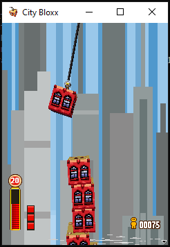
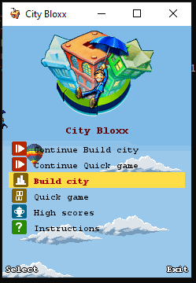
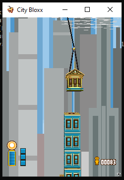
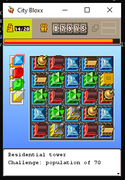
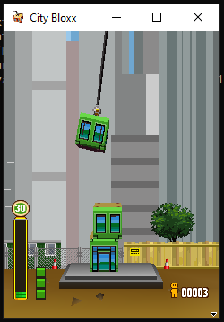
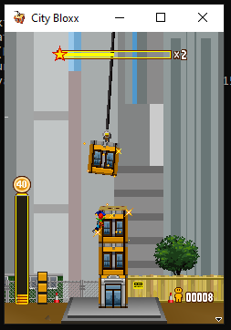
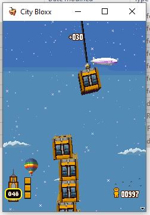
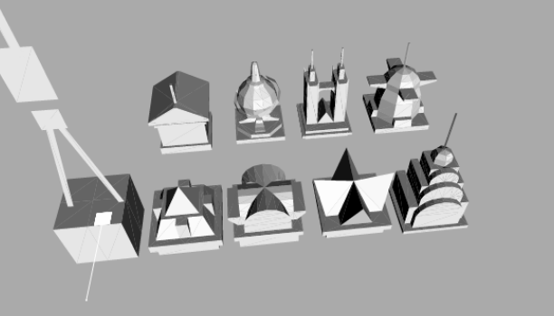
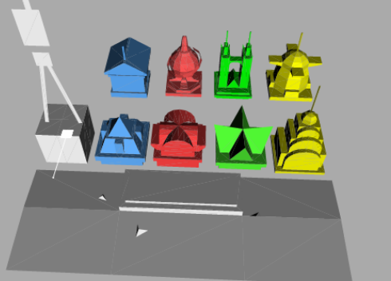
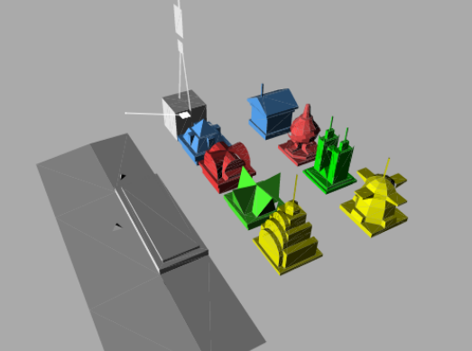

# City Bloxx - C++17 / SDL3 port

A complete rewrite of the Java *CityBloxx* reconstruction (the J2ME game *City Bloxx* with its software
3D renderer) in modern C++17 with SDL3, using **the same resources** (`assets/` is the original
`assets/` folder with `manifest.txt`, PNG images, `.mid` audio, OBJ/MTL models and `lang/` string tables) and the **same game logic**.

> **Legal / educational note** (carried over from the original project): City Bloxx, Tower Bloxx and all related
> artwork, sounds and concepts belong to Digital Chocolate / Nokia. This port exists for preservation, study and
> interoperability, strictly non-commercial.

## Preview












## Build & run

Requires a C++17 compiler and SDL3 development files (or the included `./sdl3` folder on Windows).

```sh
cmake -S . -B build -DCMAKE_BUILD_TYPE=Release
cmake --build build --config Release
./build/citybloxx            # assets are copied next to the binary
```
